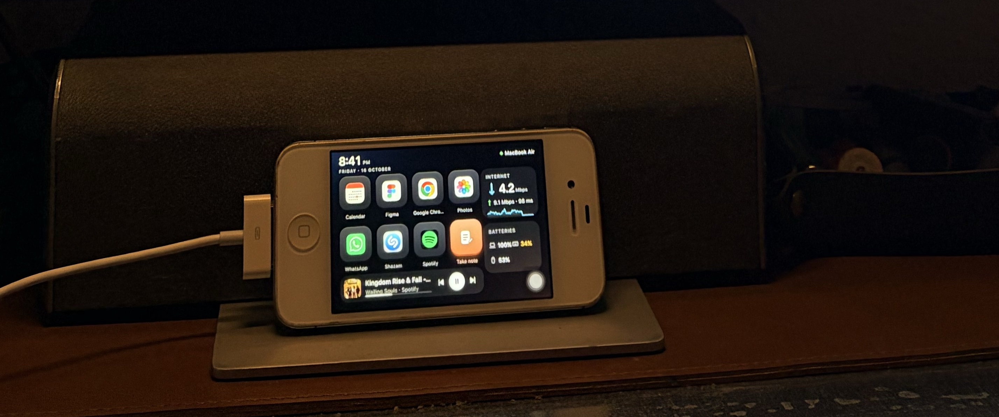
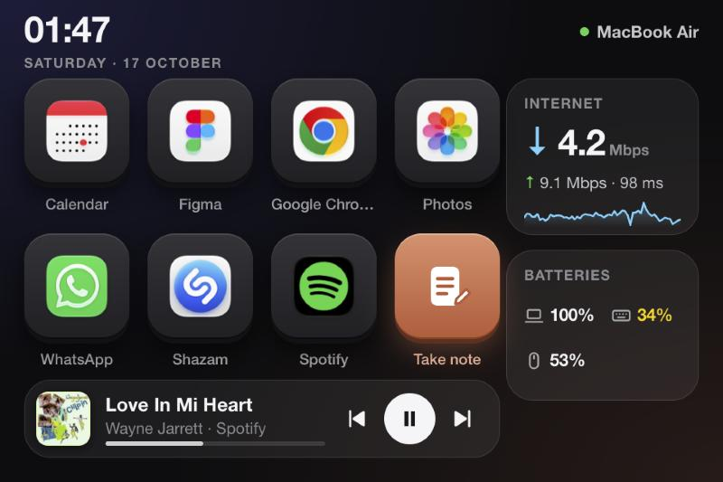
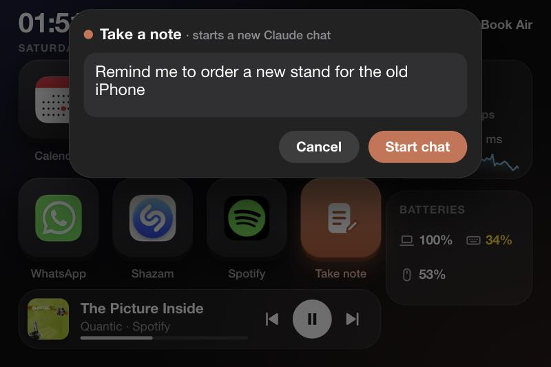
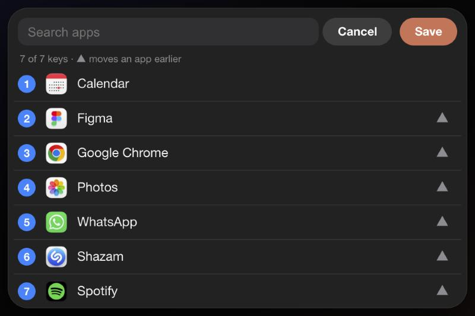

# OldPhoneDeck

**Turn an old iPhone (or any iPhone or iPad) into a Stream Deck–style control panel for your Mac.**
No jailbreak and no App Store: the deck runs in Safari, even on an iPhone 4S stuck on iOS 9.



| The deck | Take note | Pick your apps |
|---|---|---|
|  |  |  |

*Screenshots are from version 1; version 2 adds pages, widgets and the Command Center.*

## What's new in version 2

The Mac side is now **PhoneDeck.app**, a menu bar app with a **Command Center** window where you design each deck:
drag apps, widgets and controls onto pages for an iPhone 4S, a modern iPhone and an iPad, each with its own layout.
Coming from version 1? See [Upgrading from version 1](#upgrading-from-version-1).

## Features

- **Pages of keys and widgets** for three device sizes (iPhone 4S, iPhone 17-class phones, iPad mini), designed in the Command Center on the Mac. Changes reach the devices within a couple of seconds.
- **App keys** for any Mac app, Finder included, with Dock badges (WhatsApp 3, Mail 12).
- **Now playing:** artwork and progress for Spotify and Apple Music. Play/pause, next, previous and volume keys work with any player through the Mac's media keys.
- **Mac controls:** volume, brightness, dark mode, keep awake, display sleep, screenshot, mute the Mac's mic, window tiling, Focus.
- **Monitor input switching:** HDMI 1 / HDMI 2 / DisplayPort / USB-C keys switch an external monitor's input over DDC/CI. The codes in `MacControls.monitorInputs` are an MSI MD271UL's; other monitors may need different ones.
- **Widgets:** clock, weather (Open-Meteo, no key), calendar, Mac performance, internet speed, batteries (Mac, keyboard, mouse, AirPods), Bluetooth, notifications, notes with handwriting, focus timer.
- **Claude:** dictate or type on the phone and it opens a new chat in the [Claude](https://claude.ai/download) desktop app; project keys open Claude Code in a folder.
- **Integrations:** WhatsApp for Mac (recent chats, read-only, and replies), Apple Notes, YouTube in Chrome or Safari (now playing and controls), Mac notifications on every deck.
- **Webcam and mic for video calls:** a modern iPhone streams from Safari; an iPhone 4S uses the small PhoneCam app. Both feed OBS (camera) and BlackHole (mic). See [WEBCAM.md](WEBCAM.md).
- **USB cable mode for the iPhone 4S:** with no Wi-Fi, PhoneCam reaches the Mac over the cable.
- **Second monitor (optional):** `--screen` turns the phone into a small extra display with touch control.

## Requirements

- A Mac with macOS 14 or later and the Xcode Command Line Tools (`xcode-select --install`)
- An iPhone or iPad with Safari, from iOS 8/9 (iPhone 4S, 5, iPad 2…) to the latest
- Both on the same Wi-Fi network or iPhone hotspot (or a USB cable for the 4S with PhoneCam)

## Quick start

```bash
git clone https://github.com/GLAUCOMA82/OldPhoneDeck.git
cd OldPhoneDeck
./make-app.sh
open PhoneDeck.app
```

`make-app.sh` builds **PhoneDeck.app** and signs it with a local certificate it creates in `~/.phonedeck`, so macOS keeps
its permissions across rebuilds. Move the app to /Applications if you like; running `make-app.sh` again updates it there.

Then click the menu bar icon → **Connect a Device…**:

- **iPhone 4S / older iPhones:** type the address it shows into Safari, then Share → **Add to Home Screen**.
- **Modern iPhone or iPad:** scan the two QR codes. The first installs the PhoneDeck profile (needed for camera, mic and voice): install it in Settings, then turn on **PhoneDeck CA** in Settings → General → About → **Certificate Trust Settings**. The second opens the secure deck; add it to the Home Screen.

Links use your Mac's name (`Your-Mac.local`), so saved decks keep working when the Mac changes networks. If a device can't find the name, use the Mac's IP address instead (shown in the same window).

Design your pages in **Command Center…** (⌘,) from the menu bar icon.

Tips for a dedicated desk display: set **Auto-Lock → Never**, and use **Guided Access** (Settings → Accessibility) to lock the phone to the deck.

### If the profile says "Invalid Profile"

Open `http://<mac-name>.local:8045/phonedeck-ca.cer` in Safari instead: it installs the same certificate the same way.
If that shows an error page, the menu bar icon → **Show Log** says what went wrong.

### macOS permissions (asked on first use)

| Permission | Why |
|---|---|
| **Local Network** | Lets the phones reach PhoneDeck over Wi-Fi |
| **Accessibility** | Dock badges, window tiling, media keys, pressing Return in Claude |
| **Automation** (Music, Spotify, Chrome, Safari, Notes…) | Now playing, YouTube, Apple Notes |
| **Calendars** | The calendar widget |
| **Access to other apps' data** (asked once) | WhatsApp chats, read from WhatsApp's local database |
| **Full Disk Access** (optional) | Notification titles and messages from Notification Center |
| **Screen & System Audio Recording** (only with `--screen`) | The second-monitor mode |

### Running from Terminal instead

```bash
swift build -c release
.build/release/phonedeck --help
```

Permissions then go to your terminal app instead of PhoneDeck.

## Upgrading from version 1

- The app is now PhoneDeck.app (`./make-app.sh`); the old `oldphonedeck` command is gone.
- Settings live in `~/.phonedeck` instead of `~/.oldphonedeck`, so you'll pick your apps again and get a new access code.
- Modern iPhones: install the new **PhoneDeck** profile and trust **PhoneDeck CA**. You can remove the old OldPhoneDeck profile in Settings → General → VPN & Device Management.
- Add the deck to your Home Screen again from the new link.

## How it works

```
iPhone / iPad (Safari, or PhoneCam on a 4S)     Mac: PhoneDeck.app (Swift, no dependencies)
┌───────────────────────────┐  Wi-Fi / hotspot ┌────────────────────────────────────────────────┐
│ deck page (ES5 JavaScript │ ───────────────▶ │ :8045 HTTP   deck, Command Center, API          │
│  so iOS 8/9 can run it)   │                  │ :8046        PhoneCam camera + mic              │
│                           │ ───────────────▶ │ :8047 HTTPS  the same, for modern iPhones       │
│                           │      or USB      │ :8048 WSS    browser camera + mic               │
└───────────────────────────┘                  └────────────────────────────────────────────────┘
```

| Piece | Mac side |
|---|---|
| Layout | Pages and widgets for every deck in `~/.phonedeck/layout.json`, edited in the Command Center (`/studio`) |
| App keys | `NSWorkspace` lists apps, renders icons, opens them |
| Now playing | AppleScript for Spotify and Music; the Mac's media keys for any other player |
| Monitor input | DDC/CI VCP 0x60 over the display's I²C link, like brightness |
| HTTPS | A private certificate authority in `~/.phonedeck/tls`; its certificate covers the Mac's `.local` name and IP |
| USB cable | `USBTunnel.swift` keeps usbmuxd connections open to PhoneCam (port 27045 on the phone), which pipes its web view and camera through them. `PHONEDECK_USB_DEBUG=1` logs connection attempts |
| Webcam | `/camera.mjpg` for an OBS Media Source; the mic plays into BlackHole |
| Security | Every API call needs the random code in `~/.phonedeck/token`. Delete that file to rotate it |

## Limits on the iPhone 4S (iOS 9 / A5)

- The live webcam and mic need the PhoneCam app, since Safari 9 can't use the camera. See [WEBCAM.md](WEBCAM.md).
- The second-monitor stream runs at about 10–15 fps: the A5 decodes every JPEG.

## License

MIT, see [LICENSE](LICENSE). Built with [Claude Code](https://claude.com/claude-code).
