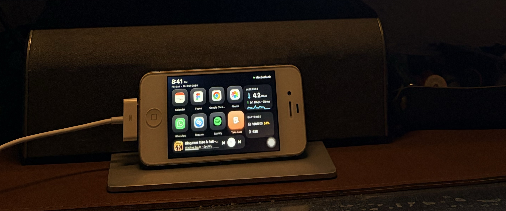
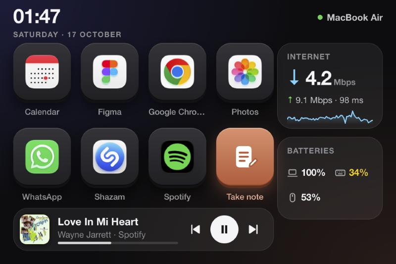
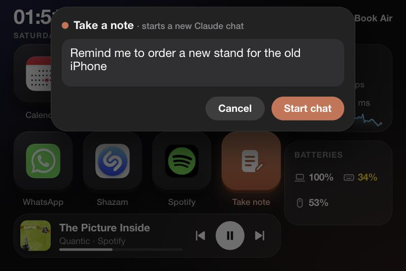
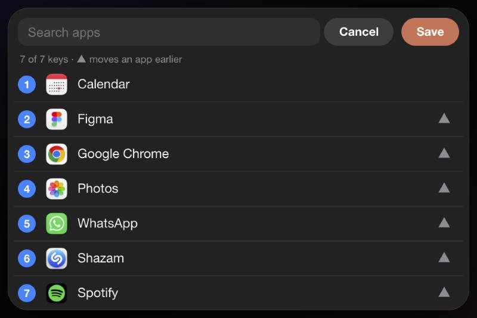

# OldPhoneDeck

**Turn an old iPhone into a Stream Deck–style control panel for your Mac.**
No jailbreak, no App Store, nothing to install on the phone: it runs in Safari, even on an iPhone 4S stuck on iOS 9.



| The deck | Take note | Pick your apps |
|---|---|---|
|  |  |  |

## Features

- **8 big keys:** 7 Mac apps of your choice, plus **Take note**. Tap a key and the app opens on your Mac. Hold any key to pick apps.
- **Take note → new Claude chat:** dictate a note, and it opens and sends a fresh conversation in the [Claude](https://claude.ai/download) desktop app.
- **Now playing:** artwork, track, progress, and previous / play-pause / next for **Spotify** or **Apple Music**.
- **Internet widget:** download, upload and ping (macOS's built-in `networkQuality`), plus a live traffic graph. Tap it to re-test.
- **Batteries widget:** MacBook, Magic Keyboard / Mouse / Trackpad and AirPods (with case), each as an icon + percentage.
- **Fits any iPhone:** a compact 480×320 layout on old phones; full-width landscape and a portrait layout on modern ones.
- **Modern iPhones also get:** voice input for Take note, and a **Phone** tab that streams the camera (into OBS) and the mic (into BlackHole) to your Mac.

## Requirements

- A Mac with macOS 14 or later and the Xcode Command Line Tools (`xcode-select --install`)
- An iPhone or iPad with Safari: anything from iOS 8/9 (iPhone 4S, 5, iPad 2…) to the latest
- Both on the same Wi-Fi network

## Quick start

```bash
git clone https://github.com/<you>/OldPhoneDeck.git
cd OldPhoneDeck
swift build -c release
.build/release/oldphonedeck
```

In a terminal it prints two links: `https://192.168.x.x:8047/#k=<token>` for modern iPhones (set up the certificate first, see below) and `http://192.168.x.x:8045/#k=<token-http>` for old ones that can't do HTTPS. On the phone:

1. Open that link in **Safari**.
2. Tap **Share → Add to Home Screen** and launch it from there to run it full screen.
3. **Hold any key** to choose your 7 apps.

Tips for a dedicated desk display: set **Auto-Lock → Never**, and use **Guided Access** (Settings → Accessibility) to lock the phone to the deck.

### macOS permissions (asked on first use)

| Permission | Why |
|---|---|
| **Accessibility** | Take note presses Return in Claude to send your note |
| **Automation → Spotify / Music** | Reading what's playing and controlling playback |

They're granted to the app you run `oldphonedeck` from (e.g. Terminal).

### Modern iPhone: voice, camera and mic (optional)

Safari only allows the microphone, camera and speech recognition on **HTTPS** pages, so OldPhoneDeck creates a private certificate authority on your Mac (stored in `~/.oldphonedeck/tls`).

1. On the iPhone, open `http://<mac-ip>:8045/oldphonedeck.mobileconfig` and tap **Allow**.
2. **Settings → Profile Downloaded → Install.**
3. **Settings → General → About → Certificate Trust Settings** → turn on **OldPhoneDeck CA**. *(Easy to miss: without it Safari keeps saying "This Connection Is Not Private".)*
4. Open `https://<mac-ip>:8047/#k=<token>` and add it to the Home Screen.

**Camera → video calls:** in [OBS](https://obsproject.com), add a *Media Source* with `http://localhost:8045/camera.mjpg?k=<token>`, then click **Start Virtual Camera**.
**Mic → video calls:** install [BlackHole 2ch](https://existential.audio/blackhole/) and restart OldPhoneDeck; pick "BlackHole 2ch" as the microphone in your call app.
*(For plain FaceTime or Zoom calls, macOS's built-in Continuity Camera is simpler.)*

## How it works

```
iPhone (Safari)                     Mac: oldphonedeck (Swift, no dependencies)
┌──────────────────────┐  Wi-Fi    ┌───────────────────────────────────────────────────┐
│ deck page            │ ────────▶ │ :8045 HTTP   page, apps, stats, music, old iPhone │
│ (ES5 JavaScript so   │           │ :8047 HTTPS  everything, Take note, camera        │
│  iOS 8/9 can run it) │ ────────▶ │ :8048 WSS    camera frames + mic audio            │
└──────────────────────┘           └───────────────────────────────────────────────────┘
```

| Feature | Mac side |
|---|---|
| App keys | `NSWorkspace` lists `/Applications`, renders icons, opens apps |
| Take note | Opens `claude://claude.ai/new?q=…` (the same link the Claude app's own macOS Service uses), then presses Return |
| Now playing | AppleScript to Spotify / Music, with a timeout so a pending permission prompt can't freeze it |
| Volume | The speaker button in the player opens a slider for the Mac's output volume, set through AppleScript run in-process (`NSAppleScript`, one thread, compiled scripts cached) |
| Internet | `/usr/bin/networkQuality -c` (tap the card) + `en*` interface byte counters: live download and upload, each with its own graph and scale |
| Activity | `host_statistics` for CPU, the GPU's `PerformanceStatistics` in IOKit, `host_statistics64` and `sysctl` for memory, pressure and swap, `ps` for the busiest apps (read only while the page asks); `GET /activity` |
| Batteries | IOKit power sources, `ioreg -r -k BatteryPercent`, `system_profiler SPBluetoothDataType` |
| HTTPS | Local CA and server certificate generated with the built-in `openssl`, served as an iOS profile |

The whole phone UI is one file, [`Sources/oldphonedeck/web/index.html`](Sources/oldphonedeck/web/index.html). It's deliberately written in ES5 (no arrow functions, `let`, `fetch`…) so iOS 8/9 Safari can run it.

## Options

```
oldphonedeck --port 8045           # HTTP port (HTTPS = port+2, WebSocket = port+3)
oldphonedeck --mic-device NAME     # audio output that receives the phone's mic (default: BlackHole)
```

Settings live in `~/.oldphonedeck/`: `token` (the access code), `token-http` (the limited code for plain HTTP), `launcher.json` (your keys), `tls/` (certificates) and the optional `config.json` (allowed networks, see Security).

## Security

- **Who can connect.** Only this Mac and private LAN addresses (10/8, 172.16/12, 192.168/16, IPv6 link-local and ULA). Tailscale and other CGNAT tailnets (100.64.0.0/10, fd7a:115c:a1e0::/48) are refused even though the Mac listens on them, and the first refusal from each address is logged. To change it, write `~/.oldphonedeck/config.json`; its `allow` list replaces the defaults (loopback is always allowed, a tailnet is allowed only if a range inside it is listed):

  ```json
  {"allow": ["192.168.1.0/24", "fe80::/10"]}
  ```

- **Two tokens.** `~/.oldphonedeck/token` opens everything, but only over HTTPS or from this Mac itself (OBS on `localhost`): on plain HTTP from the network it is refused, so it never has to cross the Wi-Fi in clear. `~/.oldphonedeck/token-http` is for old iPhones that only do plain HTTP and opens only apps, playback, volume, stats and activity (`Access.plainHTTPRoutes` in `Security.swift`). Take note, the camera and editing the keys answer `403 HTTPS required` with it.
- Tokens are compared in constant time and checked from the request head, before the body is read; bodies are capped at 64 KB, larger ones get `413`. The startup links with the tokens are printed only to a terminal, never into a log file.
- The local CA is name-constrained to the Mac's LAN /24, 127.0.0.1 and `localhost`, so even a leaked `ca.key` could not impersonate a real website on a phone that trusts it (this applies to CAs created from now on: delete `~/.oldphonedeck/tls` and reinstall the profile to get one).
- Anyone with the full link can open apps and send text to Claude on your Mac, so **treat it like a password** and **never port-forward it to the internet**.
- Delete `~/.oldphonedeck/token` or `token-http` to issue a new one.

## Troubleshooting

| Problem | Fix |
|---|---|
| Phone shows a blank page | Is the Mac on the same Wi-Fi? Check the printed IP. Old iOS can't run modern JavaScript, so if you edited `index.html`, keep it ES5. |
| "This Connection Is Not Private" | Finish step 3 of the HTTPS setup (Certificate Trust Settings). |
| Now playing stays empty | Approve macOS's "allow to control Spotify / Music" prompt, then wait a few seconds. |
| Take note opens Claude but doesn't send | Grant Accessibility to the app running `oldphonedeck`. |
| Mic says "No audio device matching BlackHole" | Install BlackHole 2ch, or ignore it if you don't use the mic. |

## Built with Claude Code

This project was built in an evening with [Claude Code](https://claude.com/claude-code). Want your own variant? Point Claude Code at this repo and ask for changes like *"add a weather widget"*, *"make the keys run Shortcuts"* or *"add a Pomodoro timer"*. Ask it to keep `index.html` ES5 if you want old iPhones to keep working.

## License

[MIT](LICENSE)
